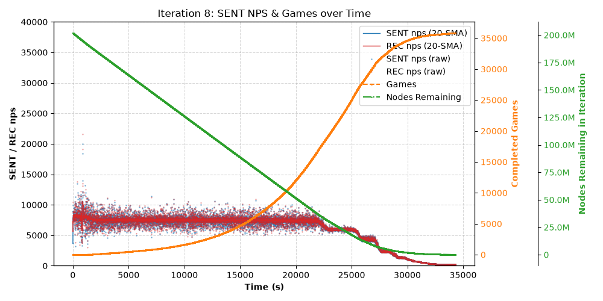
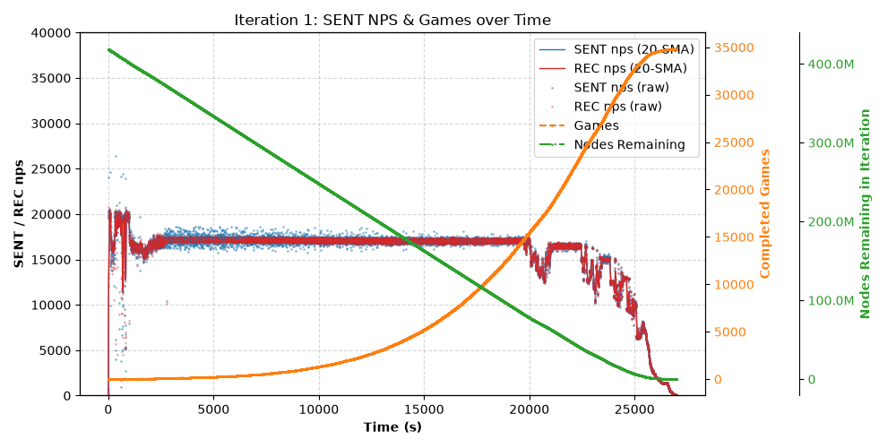

# "Mastering"* the games of TicTacToe, Connect Four, and Chess with AlphaZero

A high-performance implementation of AlphaZero [(Silver et al. 2017)](https://arxiv.org/abs/1712.01815), a reinforcement learning algorithm designed to master two-player, perfect-information games including TicTacToe, Connect Four, and Chess.

AlphaZero iterates and improves its own model output by completing self-play games using Monte-Carlo Tree Search (MCTS). These trajectories generate two supervised targets at each position:
- the policy is the distribution of visits to each possible move by the MCTS, and
- the value is the final result of the game, adjusted to the perspective of the player-to-move.

This project is an extension of Robert Förster's course [AlphaZero from Scratch - Machine Learning Tutorial](https://www.youtube.com/watch?v=wuSQpLinRB4).

> *WIP. This framework is functional but chess training is still ongoing. Further training and benchmarking are required to assess its performance.

## Example Usage
```sh
poetry install

# Run 4 self-play iterations of ConnectFour with MCTS rollouts of 30 and inferencing at b=256.
# Use 6 ResBlocks with 64 channels.
# Initialise 12 CPU workers to manage 256 games each. Train each iteration over 2 epochs at b=128.
python3 -m alphazero.selfplay c4 -r 30 -p 1 -gw 12 -gpw 512 -b 128 -ib 256 -bl 6 -ch 64 --gpu -i 4 -e 2

# Play a game of ConnectFour against the self-trained model, opting computer to play first.
python3 -m alphazero.main --s -w artifacts/connectfour_r30_p1_gw12_gpw512_b128_e2/model_003.pt --game-type c4

# Run 8 self-play iterations of chess with MCTS rollouts of 400 and inferencing at b=256.
# Initialise 34 CPU workers to manage 1024 games each. Train each iteration over 2 epochs at b=128.
python3 -m alphazero.selfplay chess -r 400 -p 1 -gw 34 -gpw 1024 -b 128 -ib 256 --gpu -i 8 -e 2

# Overrides default ResBlocks for Squeeze-and-Excite Blocks.
python3 -m alphazero.selfplay c4 --architecture se_resnet -r 30 -p 1 -gw 17 -gpw 512 -b 128 -ib 256 -bl 6 -ch 64 --gpu -i 4 -e 2
```

## High-Throughput Pipeline
The core challenge of AlphaZero is that many game trajectories are required to be generated: Deepmind used 2.3 TPU-years to train a model stronger than Stockfish 8. To achieve high throughput, multi-processed workers serve and fully saturate the GPU with batches of requests.

```
@@@@@@@@@@@@@@@@@@@@@@@@@@@@@@@@@@@@@@@@@@@@@@@@@@@@@ ~~~~~~~~~~~~~~~~~~~~~~~~~~~~~~ ###################
thread/game ──► worker queue ────► batch & dispatch ─|─► eval worker ──► re-batch ──|──► GPU
                                                                                    |    estimates 
thread/game ◄── worker inbox ◄──|─ group & dispatch ◄─── eval worker ◄── unbatch ◄──|──  policy & value
@@@@@@@@@@@@@@@@@@@@@@@@@@@@@@@@ ~~~~~~~~~~~~~~~~~~~~~~~~~~~~~~~~~~~~~~~~~~~~~~~~~~~ ###################
```
Each game worker has potentially hundreds of threads, where each thread manages a game and the MCTS instance of the current position. The workers send batched requests to eval workers, which in turn batch up requests to the GPU.

On the other side, a similar process of unbatching and dispatching responses to the destination worker occurs.

## Results
I implemented metric reporting to monitor the performance of game and eval worker processes. On Connect Four, this implementation achieves ~25k nodes/s with 32 game workers and 4 eval workers on a 18C/36T Xeon 2697v4 and RTX 3070.

Small and medium games (TicTacToe and Connect Four respectively) are an ideal test bed for prototyping and validating correctness. A strong neural net can be trained in a matter of minutes or hours.

### AlphaZero Chess
I devised a protocol to allow for any two player perfect-information game to interface with my MCTS and AZ self-play framework, allowing me to wrap an external chess library, `python-chess`.

On chess, the first iteration reached only ~2k nodes/s. Inefficient overheads were caused beyond using a bigger CNN model. I subsequently implemented several optimisations, some improving node throughput itself, others increasing node efficiency. These included reusing tree statistics for subsequent MCTS, selective deep search for a subset of positions, lazy instantiation of nodes, and reduced copying of the `Board` object.

These experiments improved the throughput to ~8k nodes/s, tapering off as games finish and batch size reduces. I further introduced both chess-specific and general refactors to increase efficiency across GPU/CPU/RAM. Key optimisations included:

- NN inference. fp16 inference, compiled model execution using torch.compile, and improved batching efficiency during times with fewer active games remaining.

- MCTS optimisation. Accelerated UCB calculations using Numba JIT compilation, and removal of game-state copies in each MCTS node in favour of applying and undoing moves during tree traversal.

- Chess-specific optimisations. Efficient repetition detection using position hashes, and cached historical board-state planes for NN input encoding.

This new version achieves a sustained 17k nodes/s throughput, with 20k possible. And the tail end is noticeably shorter.
<!-- One iteration of 35k self-play games lasted a little over a day and evaluated 600M nodes across 2M training positions. A further 6M non-training positions were fast-searched which reduced total compute by a factor of 9/16. 100M nodes worth of search was carried over from previous MCTS trees. Subsequent iterations complete faster with the model making moves with more purpose. Training is still on-going; code and results coming soon. -->



Fig 1. Acutally iteration 11 (8th iteration after resuming from a four iteration run)



Fig 2. Actually iteration 12 (1st iteration after resuming from iteration 11)

## Future Directions
### Faster Training and Inference
While this framework can fully saturate a GPU, promising future directions can reduce computation in model invocations as well as reducing the information needed (sample efficiency). The ultimate challenge is to train a AZ-style model to Grandmaster-strength in 24 hours.

Areas of interest include:
- Experimenting with mixed precision inference and training.
- Maintaining a buffer replay, reanalysis, continual model iteration.
- Being more efficient with samples by modifying the value target [(Willemsen et al. 2021)](https://link.springer.com/article/10.1007/s00521-021-05928-5).
- Using a transformer architecture to better model long-range piece interactions.

### Making Chess Engines Explainable
Engines have been outperforming humans for almost 30 years, yet to this day their evaluations are notorious for being difficult to interpret and learn from, especially for beginner and intermediate players. It is one thing to identify the best moves, but another to explain underlying strategic plans and tactical ideas at both short and long time scales.

LLMs present a useful instrument to bridge this gap, but many existing approaches integrate them poorly (in my opinion). They either make the LLM itself play chess, or they call an engine and give branches of lines as text to LLM.

Recently, the idea of integrating chess board representations directly into language models has emerged [(Bhaskar et al. 2026)](https://arxiv.org/html/2610.03695v1). I believe text tokens attending to rich board features is key to grounded and insightful explanations. This is a promising and fascinating area of research that would not only contribute to chess pedagogy but also broadly to Explainable AI research.

## Tangent: A Critical View of AlphaZero
On a slight tangent, when I first heard about AlphaZero, I thought it was so profound to imagine a computer fighting with, and learning from, itself in an intellectual duel. But many years later when I read the papers and compared AlphaGo (the version that beat 9-dan pro Lee Sedol in the famous 2016 match) to AlphaGo Zero, I realised it was brutally simpler yet more elegant than I had thought. AlphaGo and traditional MCTS both generate actual rollouts to the end of the game to estimate the value of a position. AlphaGo Zero removes rollouts entirely. To anthropomorphise it, it says "You know what? I've searched deep enough. Rollouts are just as noisy; I'll just guess the outcome from here (conditioned on myself playing in self-play mode with all the associated exploration tweaks)," and in lieu uses its value output -- one of the two targets improved over self-play iterations -- at that leaf position. This is a kind of boot-strapping; to have an accurate estimate of the present requires a good estimate of the future, which in turn requires a good estimate of the future's future. This inductive chain only resolves because at some point the game does definitively end with a known result.

It might be eye-opening for you to reframe AlphaZero as "amortized planning" just as Deepmind did in [(Ruoss et al. 2024)](https://arxiv.org/abs/2402.04494). So much for seeming like a civilised or human-like player, evaluating only thousands of moves per position, compared to the millions of a traditional chess engine like Stockfish. Because a trained AlphaZero-type model will have done the extensive search at train-time over a vast and diverse range of positions. In principle, it will have learnt all the relevant features of a chess board to more-than-adequately provide a value estimate for any given position. However, there is nothing inherent about value estimation that requires self-play RL. A substitute for this would be to look at human games and consult each position's winning statistics. Even better, consult with a chess engine so powerful that we consider it as an 'oracle' for the value and best action.

But how to surpass the teacher? This is where we turn to RL and self-play. AlphaZero uses two blades to sharpen each other (though they are actually the same). This self-duel firstly enriches the training examples for more critical, closely-fought positions to search for that tiny extra edge. Secondly, just like a Grandmaster has an intuition of good candidate moves in a position, we introduce the policy target to focus our MCTS search, "I should have focussed more on these and ignore those." This is a virtuous cycle: MCTS hones the value estimation and prior beliefs; better estimates and beliefs lead to deeper and more accurate searches. The bulk of self-play's benefit doesn't come from white fighting black. The two sides are just puppets. It's the refinement that comes from inside each agent's 'mind' when it plays against itself in the MCTS tree. The self-play match is just a vessel to discover diverse and critical positions and ultimately bring games to a conclusive result.

Finally the true elegance of AlphaZero emerges. As DeepMind described it, this use of MCTS is simultaneously "a powerful policy improvement operator" and "a powerful policy evaluation operator". In other words, the MCTS acts as both the judge and teacher, and though it is brute-force at heart, it turns AlphaZero into a self-sustaining engine of improvement.

## References

1. **Silver, D., Huang, A., et al. (2016).** [Mastering the Game of Go with Deep Neural Networks and Tree Search](https://www.nature.com/articles/nature16961). *Nature*, 529, 484–489.

2. **Silver, D., Schrittwieser, J., et al. (2017).** [Mastering the Game of Go without Human Knowledge](https://www.nature.com/articles/nature24270). *Nature*, 550, 354–359.

3. **Silver, D., Hubert, T., et al. (2017).** [Mastering Chess and Shogi by Self-Play with a General Reinforcement Learning Algorithm](https://arxiv.org/abs/1712.01815). *arXiv:1712.01815*.

4. **Willemsen, D., Baier, H., et al. (2021).** [Value targets in off-policy AlphaZero: a new greedy backup](https://link.springer.com/article/10.1007/s00521-021-05928-5) *Neural Comput & Applic 34, 1801–1814*.

5. **Ruoss, A., Delétang, G., et al. (2024).** [Amortized Planning with Large-Scale Transformers: A Case Study on Chess](https://arxiv.org/abs/2402.04494). *arXiv:2402.04494*.

6. **Bhaskar, A., Cheng, J., & Chen, D. (2026).** [Language Models that Play Chess and Explain Their Moves](https://arxiv.org/abs/2610.03695). *arXiv:2610.03695*.
